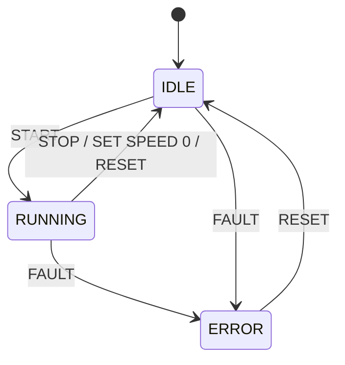

# Motor Controller Protocol

## 1. Overview

This simulator emulates a simplified industrial motor controller. It listens for TCP connections on port 9000 and accepts one client at a time. When a client connects, the device sends `READY`. The client can then send commands as ASCII text, one command per line, and the device replies with one line per command.

## 2. Message Format

### Line format

- Each command must end with `\n` or `\r\n`. The line ending is not part of the command. 
- Words are separated by exactly one space. Commands are uppercase only.

### Valid integer

An integer is `0`, or an optional minus sign followed by a digit 1–9 and then any digits. For example, `0`, `10` and `-10` are valid. `+10`, `010` and `-0` are not valid.

### Validation order

The device checks each line in this order and returns the first error that applies: 
1. The line does not exactly match a valid form (see Section 5) → `ERR 1` 
2. The `SET SPEED` parameter is outside 0–100 → `ERR 2` 
3. The command is not allowed in the current state → `ERR 3`

### Commands and parameters

- A line must match one of the known commands exactly, including the number of parameters; otherwise the device returns `ERR 1`. Commands are uppercase only, so `start` returns `ERR 1`.
- Missing parameter returns `ERR 2`.
- A numeric parameter must be an integer (a leading minus sign is allowed); otherwise the device returns `ERR 2`.
- A numeric parameter must be between 0 and 100; otherwise the device returns `ERR 3`.

### Replies

Every reply ends with `\n`. There are two types of reply:
- Success: `OK STATE=<state> SPEED=<speed>`,
  for example `OK STATE=RUNNING SPEED=50`
- Error: `ERR <code> <NAME>`
  for example `ERR 3 OUT_OF_RANGE`

## 3. States

The device has three states:

- **IDLE**: The motor is stopped. The device accepts commands, including `SET SPEED` to prepare the speed before starting.
- **RUNNING**: The motor is running at the set speed.
- **ERROR**: The device enters ERROR when it receives `FAULT`. The motor stops and the speed is set to 0. In this state the device accepts only `RESET` and `STATUS`; all other commands return `ERR 3`.

The device starts in IDLE with speed 0.

The speed in every reply is the set speed: the speed the motor runs at when it is in RUNNING. It is not the actual motor speed.

Note: an `ERR` reply to an invalid command does not change the state. Only `FAULT` puts the device into ERROR.

## 4. Commands

### START 
- **Syntax:** `START` 
- **Parameters:**  None
- **Description:** Starts the motor at the set speed. Allowed only in IDLE when the set speed is greater than 0. 
- **Success response:** `OK STATE=RUNNING SPEED=<speed>` 
- **Errors:** 
   - `ERR 3 NOT_ALLOWED`: the speed is set to 0, the device is already RUNNING, or the device is in ERROR 
   - `ERR 1 INVALID_COMMAND`: a parameter is given, for example `START 50`    
- **Example:** 
   - Send `SET SPEED 50`, receive `OK STATE=IDLE SPEED=50` 
   - Send `START`, receive `OK STATE=RUNNING SPEED=50`

### STOP 
- **Syntax:** `STOP` 
- **Parameters:**  None
- **Description:** Stops the motor when running. The device switches to IDLE mode. If current status is IDLE, the command STOP does not return an error; the device stays in IDLE.
- **Success response:** `OK STATE=IDLE SPEED=0` 
- **Errors:** 
   - `ERR 1 INVALID_COMMAND`: a parameter is given, for example `STOP 50` 
   - `ERR 3 NOT_ALLOWED`: The device is in ERROR.
- **Example:** 
   - Send `STOP`, receive `OK STATE=IDLE SPEED=0`    

### SET SPEED ###
- **Syntax:** `SET SPEED <n>`  
- **Parameters:**  One integer, 0-100
- **Description:** Sets the speed before `START` or changes the speed while running. The command `SET SPEED 0` equals `STOP` command in RUNNING status. The speed is a percentage of the maximum motor speed.
- **Success response:** `OK STATE=<state> SPEED=<n>` 
- **Errors:** 
   - `ERR 2 OUT_OF_RANGE`: the set speed is out of range from 0 to 100. For example `SET SPEED 110` or `SET SPEED -10`
   - `ERR 1 INVALID_COMMAND`: the line does not exactly match SET SPEED <n>. 
    Example: `SET SPEED 10.5` 
    Example: `SET SPEED `  ( trailing space )
    Example `SPEED 10` ( `SET` is missing )  or  `SET SPEED` (parameter missing)
    Example `SET SPEED 10 60` (  an extra parameter )
   - `ERR 3 NOT_ALLOWED`: in ERROR mode, a valid set speed command will receive this. 
- **Example:** 
   - Send `SET SPEED 0` (RUNNING mode), receive `OK STATE=IDLE SPEED=0`  ( Same result with STOP command )
   - Send `SET SPEED 50`, receive `OK STATE=IDLE SPEED=50`  (current status IDLE)
   - Send `SET SPEED 60`, receive `OK STATE=RUNNING SPEED=60`  (current status RUNNING)

### STATUS 
- **Syntax:** `STATUS` 
- **Parameters:**  None
- **Description:** Returns the current state and speed. The state and speed do not change.
- **Success response:** `OK STATE=<state> SPEED=<speed>` 
- **Errors:** 
   - `ERR 1 INVALID_COMMAND`: unknown command, for example `STATUS 50`    
- **Example:** 
   - Send `STATUS`, receive `OK STATE=IDLE SPEED=10` 
   - Send `STATUS`, receive `OK STATE=ERROR SPEED=0` 

### FAULT 
- **Syntax:** `FAULT` 
- **Parameters:**  None
- **Description:** Simulates a hardware fault. The device enters ERROR, the motor stops and the speed is set to 0. Then it can only return to IDLE mode after receiving RESET command. In ERROR, the device accepts only `RESET` and `STATUS`.
- **Success response:** `OK STATE=ERROR SPEED=0` 
- **Errors:** 
   - `ERR 1 INVALID_COMMAND`: not uppercase, for example `fault`    
   - `ERR 3 NOT_ALLOWED`: the device is in ERROR  
- **Example:** 
   - Send `FAULT` while RUNNING, receive `OK STATE=ERROR SPEED=0` .Then send `START` command, receive `ERR 3 NOT_ALLOWED`.

### RESET 
- **Syntax:** `RESET` 
- **Parameters:**  None
- **Description:** Resets the device to IDLE with speed 0. Allowed in any state.
- **Success response:** `OK STATE=IDLE SPEED=0` 
- **Errors:** 
   - `ERR 1 INVALID_COMMAND`: command does not match the known commands. 
     For example `RESETING` ( unknown command )
     For example `RESET 60` (  an extra parameter )    
- **Example:** 
   - Send `RESET` while in ERROR mode, receive `OK STATE=IDLE SPEED=0`

## 5. Error Codes

 Errors are checked in the order described in Section 2, Validation order.

| Error Code | Name            | Conditions                                                                                                                                                                                                                                                                                                                                                                                                       |
| ---------- | --------------- | ---------------------------------------------------------------------------------------------------------------------------------------------------------------------------------------------------------------------------------------------------------------------------------------------------------------------------------------------------------------------------------------------------------------- |
| ERR 1      | INVALID_COMMAND | The line does not exactly match one of these valid forms: `START`, `STOP`, `STATUS`, `FAULT`, `RESET`, `SET SPEED <n>` where `<n>` is a valid integer (see Section 2). A valid integer outside 0–100 returns `ERR 2`. Examples: an empty line, `start`, `START 50`, `SET SPEED`, ` START` (leading space), `START ` (trailing space), `SET  SPEED 10`(extra space), `SET SPEED abc`, `SET SPEED +10` |
| ERR 2      | OUT_OF_RANGE    | The `SET SPEED` parameter is a valid integer outside 0–100, however large: `SET SPEED -1`, `SET SPEED 101`, `SET SPEED 99999999999`                                                                                                                                                                                                                                                                           |
| ERR 3      | NOT_ALLOWED     | The command is valid but not allowed in the current state, for example `START` when the speed is 0 or the device is already RUNNING, or any command except `RESET` and `STATUS` in ERROR.                                                                                                                                                                                                                        |
| ERR 4      | BUSY            | The device is occupied by one client, so a second client that tries to connect receives this error and is disconnected. (connection-level, not a reply to a command)                                                                                                                                                                                                                                             |

## 6. State Transitions

| Current state | `START`                                    | `STOP`            | `SET SPEED n` (1–100)    | `SET SPEED 0`         | `FAULT`            | `RESET`               | `STATUS`  |
| ------------- | ------------------------------------------ | ----------------- | ------------------------ | --------------------- | ------------------ | --------------------- | --------- |
| **IDLE**      | speed > 0: → RUNNING speed = 0: `ERR 3` | stays IDLE        | stays IDLE, speed = n    | stays IDLE, speed = 0 | → ERROR, speed = 0 | stays IDLE, speed = 0 | no change |
| **RUNNING**   | `ERR 3`                                    | → IDLE, speed = 0 | stays RUNNING, speed = n | → IDLE, speed = 0     | → ERROR, speed = 0 | → IDLE, speed = 0     | no change |
| **ERROR**     | `ERR 3`                                    | `ERR 3`           | `ERR 3`                  | `ERR 3`               | `ERR 3`            | → IDLE, speed = 0     | no change |

## 7. Connection Behavior

The device accepts one client at a time. If a second client connects while another client is connected, the device sends `ERR 4 BUSY` to the second client and closes TCP connection. The second client does not receive `READY`, and the device state does not change.
