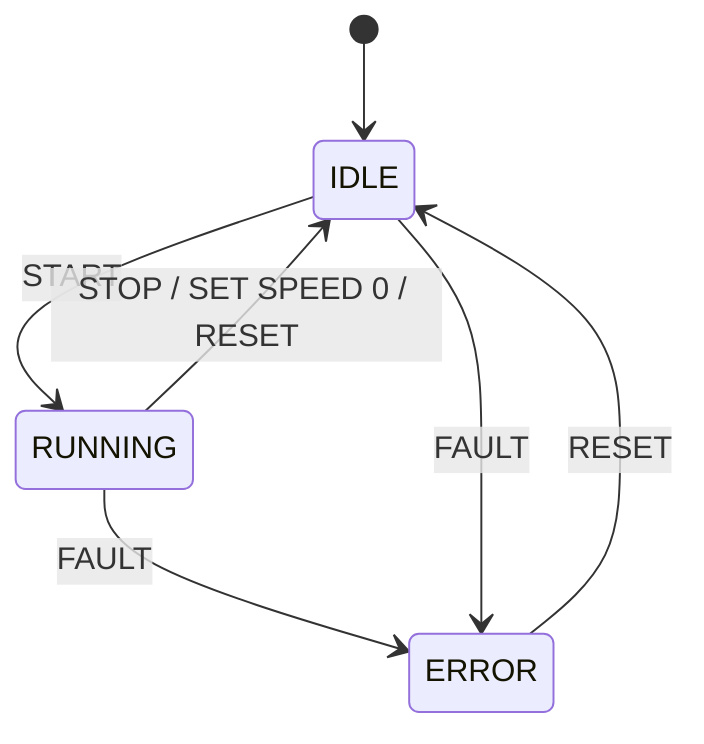

# Motor Controller Protocol

## 1. Overview

This simulator emulates a simplified industrial motor controller. It listens for TCP connections on port 9000 and accepts one client at a time. When a clients connects, the device sends `READY`. The client can then send commands as ASCII text, one command per line, and the device replies with one line per command.

## 2. Message Format

### Line format

- Each command must end with `\n` or `\r\n`.
- Words must be separated by exactly one space.
- Two or more consecutive spaces between words return `ERR 2`.
- A space before the first non-space character returns `ERR 2`.
- A space after the last non-space character returns `ERR 2`.
- A line that is empty or contains only spaces returns `ERR 1`.

### Commands and parameters

- A line must match one of the known commands exactly, including the number of parameters; otherwise the device returns `ERR 1`. Commands are uppercase only, so `start` returns `ERR 1`.
- Missing parameter returns `ERR 2`.
- A numeric parameter must be an integer (a leading minus sign is allowed); otherwise the device returns `ERR 2`.
- A numeric parameter must be between 0 and 100; otherwise the device returns `ERR 3`.

### Replies

Every reply ends with `\n`. There are two types of reply:
- Success: `OK STATE=<state> SPEED=<speed>`,
  for example `OK STATE=RUNNING SPEED=50`
- error: `ERR <code> <NAME>`
  for example `ERR 3 OUT_OF_RANGE`

## 3. States

The device has three states:

- **IDLE**: The motor is stopped. The device accepts commands, including `SET SPEED` to prepare the speed before starting.
- **RUNNING**: The motor is running at the set speed.
- **ERROR**: The device enters ERROR when it receives `FAULT`. The motor stops and the speed is set to 0. In this state the device accepts only `RESET` and `STATUS`; all other commands return `ERR 4`.

The device starts in IDLE with speed 0.

The speed in every reply is the set speed: the speed the motor runs at when it is in RUNNING. It is not the actual motor speed.

Note: an `ERR` reply to an invalid command does not change the state. Only `FAULT` puts the device into ERROR.

## 4. Commands

### START
- **Syntax:** `START`
- **Parameters:**  None
- **Description:** Starts the motor at the set speed. Allowed only in IDLE when the set speed is greater than 0.
- **Success response:** `OK STATE=RUNNING SPEED=<speed>`
- **Errors:**
    - `ERR 4 NOT_ALLOWED`: the speed is set to 0, the device is already RUNNING, or the device is in ERROR
    - `ERR 1 UNKNOWN_COMMAND`: a parameter is given, for example `START 50`
- **Example:**
    - Send `SET SPEED 50`, receive `OK STATE=IDLE SPEED=50`
    - Send `START`, receive `OK STATE=RUNNING SPEED=50`

### STOP
- **Syntax:** `STOP`
- **Parameters:**  None
- **Description:** Stops the motor when running. The device switches to IDLE mode. If current status is IDLE, the command STOP does not return an error; the device stays in IDLE.
- **Success response:** `OK STATE=IDLE SPEED=0`
- **Errors:**
    - `ERR 1 UNKNOWN_COMMAND`: a parameter is given, for example `STOP 50`
    - `ERR 4 NOT_ALLOWED`: The device is in ERROR.
- **Example:**
    - Send `STOP`, receive `OK STATE=IDLE SPEED=0`

### SET SPEED
- **Syntax:** `SET SPEED <n>`
- **Parameters:**  One integer, 0-100
- **Description:** Sets the speed before `START` or changes the speed while running. The command `SET SPEED 0` equals `STOP` command in RUNNING status. The speed is a percentage of the maximum motor speed.
- **Success response:** `OK STATE=<state> SPEED=<n>`
- **Errors:**
    - `ERR 3 OUT_OF_RANGE`: the set speed is out of range from 0 to 100. For example `SET SPEED 110` or `SET SPEED -10`
    - `ERR 2 INVALID_FORMAT`: a parameter is missing or not an integer. For example `SET SPEED 10.5` or `SET SPEED`
    - `ERR 1 UNKNOWN_COMMAND`: command does not match the known commands.
      For example `SPEED 10` ( `SET` is missing )
      For example `SET SPEED 10 60` (  an extra parameter )
    - `ERR 4 NOT_ALLOWED`: in ERROR mode, a valid set speed command will receive this.
- **Example:**
    - Send `SET SPEED 0` (RUNNING mode), receive `OK STATE=IDLE SPEED=0`  ( Same result with STOP command )
    - Send `SET SPEED 50`, receive `OK STATE=IDLE SPEED=50`  (current status IDLE)
    - Send `SET SPEED 60`, receive `OK STATE=RUNNING SPEED=60`  (current status RUNNING)

### STATUS
- **Syntax:** `STATUS`
- **Parameters:**  None
- **Description:** Returns the current state and speed. The state and speed do not change.
- **Success response:** `OK STATE=<state> SPEED=<speed>`
- **Errors:**
    - `ERR 1 UNKNOWN_COMMAND`: unknown command, for example `STATUS 50`
- **Example:**
    - Send `STATUS`, receive `OK STATE=IDLE SPEED=10`
    - Send `STATUS`, receive `OK STATE=ERROR SPEED=0`

### FAULT
- **Syntax:** `FAULT`
- **Parameters:**  None
- **Description:** Simulates a hardware fault. The device enters ERROR, the motor stops and the speed is set to 0. Then it can only return to IDLE mode after receiving RESET command. In ERROR, the device accepts only `RESET` and `STATUS`.
- **Success response:** `OK STATE=ERROR SPEED=0`
- **Errors:**
    - `ERR 1 UNKNOWN_COMMAND`: unknown command, for example `fault`
    - `ERR 4 NOT_ALLOWED`: the device is in ERROR
- **Example:**
    - Send `FAULT` while RUNNING, receive `OK STATE=ERROR SPEED=0` .Then send `START` command, receive `ERR 4 NOT_ALLOWED`.

### RESET
- **Syntax:** `RESET`
- **Parameters:**  None
- **Description:** Resets the device to IDLE with speed 0. Allowed in any state.
- **Success response:** `OK STATE=IDLE SPEED=0`
- **Errors:**
    - `ERR 1 UNKNOWN_COMMAND`: command does not match the known commands.
      For example `RESETING` ( unknown command )
      For example `RESET 60` (  an extra parameter )
- **Example:**
    - Send `RESET` while in ERROR mode, receive `OK STATE=IDLE SPEED=0`
 

## 5. Error Codes

 General rule: Format and range errors (`ERR 1`, `ERR 2`, `ERR 3`) are checked before the state. `ERR 4` is returned only for commands that are otherwise valid.

| Error Code | Name            | Conditions                                                                                                                                                                                         |
| ---------- | --------------- | -------------------------------------------------------------------------------------------------------------------------------------------------------------------------------------------------- |
| ERR 1      | UNKNOWN_COMMAND | The command does not match a known command: an empty line or a line with only spaces, `start`, `BEGIN`, `START 50`, `&&&` ...                                                                   |
| ERR 2      | INVALID_FORMAT  | The command starts or ends with space character or extra space character between command words:  ` START`, `START `, `SET  SPEED 10` The `SET SPEED` parameter is missing or not an integer. |
| ERR 3      | OUT_OF_RANGE    | The parameter is out of range from 0 to 100                                                                                                                                                        |
| ERR 4      | NOT_ALLOWED     | The command is valid but not allowed in the current state, for example `START` when the speed is 0 or the device is already RUNNING, or any command except `RESET` and `STATUS` in ERROR.          |
| ERR 5      | BUSY            | The device is occupied by one client, so a second client that tries to connect receives this error and is disconnected.                                                                            |

## 6. State Transitions

| Current state | `START`                                    | `STOP`            | `SET SPEED n` (1–100)    | `SET SPEED 0`         | `FAULT`            | `RESET`               | `STATUS`  |
| ------------- | ------------------------------------------ | ----------------- | ------------------------ | --------------------- | ------------------ | --------------------- | --------- |
| **IDLE**      | speed > 0: → RUNNING speed = 0: `ERR 4` | stays IDLE        | stays IDLE, speed = n    | stays IDLE, speed = 0 | → ERROR, speed = 0 | stays IDLE, speed = 0 | no change |
| **RUNNING**   | `ERR 4`                                    | → IDLE, speed = 0 | stays RUNNING, speed = n | → IDLE, speed = 0     | → ERROR, speed = 0 | → IDLE, speed = 0     | no change |
| **ERROR**     | `ERR 4`                                    | `ERR 4`           | `ERR 4`                  | `ERR 4`               | `ERR 4`            | → IDLE, speed = 0     | no change |

## 7. Connection Behavior

The device accepts one client at a time. If a second client connects while another client is connected, the device sends `ERR 5 BUSY` to the second client and closes TCP connection. The second client does not receive `READY`, and the device state does not change.
